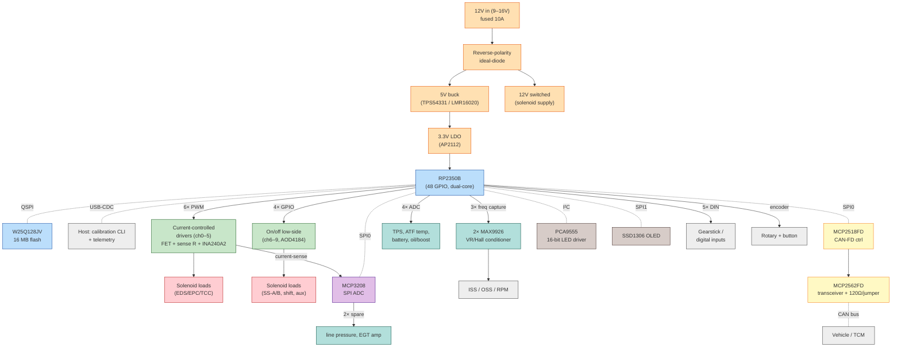

# revL — Universal multi-transmission controller PCB

> **Status:** Design spec v0.1 (pre-layout). Netlist + architecture locked; this
> document is the source of truth for the KiCad/Altium handoff. Routing is TBD.
>
> **Goal:** One SMD board that drives **any** transmission OpenShift supports
> today or plans to: GM 4L60E/4L80E, Mercedes 722.6, GM 6L80, Ford 4R70W,
> ZF 8HP, and GM/Ford 10-speed (10L80/10R80) units — by exposing a **superset**
> of actuator and sensor channels addressed by the existing
> `transictrl` calibration `io_mapping` model.
>
> **Bring-up priority:** **4L60E/4L80E first** (only unit on hand for physical
> testing) → 8HP (headline new design goal, gated on obtaining a unit) →
> remaining transmissions. See §10.1 and §11 step 5.

---

## 1. Why revL exists

The three prior revisions (H/I/K) are hard-wired for the **722.6** on a
**Teensy 3.5**:

- revH (through-hole, 226.7 × 170.3 mm) — 12× on/off `IRF540N` low-side
  MOSFETs, 2× `MAX9926` VR conditioners, 7805 regulators.
- revK (SMD, 123.8 × 106.6 mm) — the current daily driver, same topology.

That topology cannot drive **proportional / current-controlled** solenoids
(EDS pressure regulators, EPC, PWM TCC) that the newer transmissions need.
revL keeps **backward compatibility with the 722.6** while adding the
current-controlled driver class, CAN-FD, more speed-sensor and analog
channels, and modern power protection — so it becomes the single carrier for
the whole `transictrl` platform.

### Software alignment (already built for this)

The Rust core is *already* sized for multi-transmission use:

| Abstraction (`transictrl-core`) | Value | revL channel it maps to |
| -- | -- | -- |
| `MAX_GEARS` | `10` | (covers 8HP/10-speed gear count) |
| `MAX_ELEMENTS` | `6` | 6 element driver channels |
| `Outputs.epc_permille` | line pressure | dedicated EPC current channel |
| `Outputs.tcc_duty_pct` | converter lockup | dedicated TCC current channel |
| `Outputs.elements[6]` | shift-element states | 6 driver channels |
| HAL `OutputPin` vs `SolenoidCurrent`/`PwmOutput` | on/off vs proportional | the two driver groups below |
| `CalibrationFile.io_mapping` | per-channel addressing | physical channel numbers |

Reference: `4l60e.toml` maps SS-A/SS-B (on/off) + EPC/TCC/3-2 (PWM);
`transictrl-722` maps Y3/Y4/Y5 + MPC/SPC/TCC. **Both fit inside revL's
10-channel budget.**

---

## 2. Design decisions (locked)

| Item | Decision | Rationale |
| -- | -- | -- |
| MCU | **RP2350B** (QFN-60, 48 GPIO) | User choice. The A variant (30 GPIO) is already maxed by the 722.6 signals alone; the B variant is required. |
| Driver topology | **Mixed: 6 current-controlled + 4 on/off** | Covers EDS/EPC/TCC class *and* on/off shift solenoids across all targets. |
| Channel count | **10 solenoid channels** | 6 elements + EPC + TCC + 2 spares (boost/speedo/fuel/horn). |
| Speed sensors | **3 VR/Hall channels** | ISS + OSS + (engine RPM / intermediate). |
| Layer stack | **4-layer** (rec.) | Analog current-sense + high-current solenoid loops need a GND plane + power plane; revK's 2-layer is insufficient for SI. |
| I/O expansion | **PCA9555** (I²C, 16-bit) for status LEDs | Frees MCU GPIO for the channel-heavy design. |
| External ADC | **MCP3208** (SPI, 8-ch) | Dedicated ADC for 6× solenoid current-sense feedback + line pressure + EGT amp — decouples fast closed-loop from slow sensor reads. |
| CAN | **MCP2518FD** + **MCP2562FD** (CAN-FD) | RP2350 has no native CAN; modern units (8HP/10-speed) need CAN↔ECM. |
| CAN termination | **120Ω + 0Ω jumper** | Board may sit mid-bus; strap disablable. |
| Persistence | RP2350 last-sector flash | No extra IC; optional I²C FRAM footprint for wear-free writes. |
| Backward compat | **Yes** — superset of revK channels | 722.6 calibrations run unchanged. |

---

## 3. Block diagram



---

## 4. Power tree

```
12V (9–16V, fused 10A)
├── Reverse polarity: ideal-diode (LM74610) or P-FET + Schottky   [NEW vs revK]
├── 12V switched rail ───────────────► solenoid loads (10 ch)
│   └── 1000µF bulk + local 100nF/1µF per driver
└── 5V buck (TPS54331 / LMR16020, ≥2A)                            [replaces 7805×2]
    ├── 5V digital (OLED, CAN xceiver, logic)
    └── 3.3V LDO (AP2112/TLV73333)
        └── RP2350 core / I-O / analog
```

- **5V rail** must source: RP2350 (~30 mA) + OLED (~20 mA) + CAN xceiver (~70 mA peak) + logic = <200 mA → buck sized with >5× headroom.
- **12V solenoid rail** is the high-current path — keep its return as a separate, heavy copper pour back to the input connector (star ground), isolated from the 3.3V analog ground until the single board GND node.
- **Power budget note**: 10 channels × ~2 A worst case = 20 A, which **exceeds the user's 10 A fuse**. See §9 (verification) — spec a per-channel current limit; simultaneous full-load operation is not assumed.

---

## 5. Solenoid driver detail

### Group A — current-controlled (channels 0–5)

Per channel:
- Low-side N-channel logic-level MOSFET (e.g. **AOD4184A**, SOT-223 class).
- Source → current-sense resistor (**50 mΩ**, 1%, ≥1 W).
- **INA240A2** bidirectional current-sense amp across the resistor → MCP3208 ADC input.
- RP2350 PWM slice → gate via small gate resistor (47–100Ω); optional
  **TC4427**/**LM5111** gate driver on the two highest-current channels if
  Miller plateau at 3.3 V drive is a concern at high dV/dt.
- Flyback: **SMAJ18A** TVS or fast Schottky (e.g. **SS54**) across each load
  pair (supersedes revK's 1N4001 array — faster clamp, lower voltage).
- RP2350 closes the loop in firmware: set `SolenoidCurrent::set_current_permille`
  → target ADC counts → duty adjustment (implements the HAL `SolenoidCurrent` trait).
  Group A is a **superset** driver: it also serves plain PWM (open-loop duty)
  solenoids by ignoring the current feedback, so 4L60E's PWM TCC/3-2 solenoids
  land on Group A channels — no separate PWM-only driver class needed.

**Channel assignment (provisional — calibrations address these by number):**

| Ch | Class | 4L60E / 4L80E role | 8HP role | Other |
| -- | -- | -- | -- | -- |
| 0 | A (CC/PWM) | TCC PWM | Brake A | 722.6 MPC |
| 1 | A (CC/PWM) | 3-2 control PWM | Brake B | 722.6 SPC |
| 2 | A (CC/PWM) | *(spare proportional)* | Clutch C | aux PWM |
| 3 | A (CC/PWM) | *(spare proportional)* | Clutch D | aux PWM |
| 4 | A (CC/PWM) | *(spare proportional)* | Clutch E | aux PWM |
| 5 | A (CC) | **EPC** (closed-loop current) | EDS line pressure | 6L80/4R70 EPC |

EPC (ch5) is always closed-loop current-controlled; the rest of Group A can run
closed-loop *or* open-loop PWM per the calibration's `frequency_hz`.

### Group B — on/off low-side (channels 6–9)

Per channel:
- Logic-level N-MOSFET (**AOD4184A** or **AO3400A** for <2 A loads) low-side.
- Gate resistor from RP2350 GPIO; pulldown on gate (10 kΩ) for power-on safety.
- Flyback Schottky across load; status LED on the PCA9555 expander (not the GPIO).

| Ch | Class | 4L60E / 4L80E role | Other |
| -- | -- | -- | -- |
| 6 | B (on/off) | **SS-A** | 722.6 Y3; 4R70W SS1 |
| 7 | B (on/off) | **SS-B** | 722.6 Y4; 4R70W SS2 |
| 8 | B (on/off) | *(spare on/off)* | 722.6 Y5; 4R70W SS3; 6L80 sol |
| 9 | B (on/off) | *(spare on/off)* | 722.6 aux: boost/fuel/speedo/horn |

> **Note on TCC:** the 4L60E/4L80E torque-converter clutch is a **PWM**
> solenoid, so it maps to a Group A channel (ch0), **not** an on/off channel.
> Channel 9 is therefore free for the legacy 722.6 auxiliary outputs rather
> than carrying TCC. (Earlier draft had ch9 as "TCC/aux on/off with a PWM strap"
> — that was dropped because the Group A superset already covers PWM TCC.)

---

## 6. Speed-sensor inputs (3 channels)

- **2× MAX9926UAEE+** (2-channel VR conditioner each) → use 3 of 4 channels.
- VR/Hall selectable per channel via resistor/jumper footprint.
- Conditioned output → RP2350 GPIO routed to a PIO/counter for `FrequencyCapture`.
- **Fixes the known N2/N3 issue:** provision a **0Ω jumper** footprint in the
  series-resistor position (replaces revK's forced 2Ω R29 that the user must
  cut/bridge). Default strap = 0Ω (wire).

| Channel | Default role |
| -- | -- |
| 0 | ISS / turbine (722.6 N2) |
| 1 | OSS / output (722.6 N3) |
| 2 | engine RPM / vehicle speed / intermediate |

---

## 7. Analog inputs

| Source | ADC | Channel |
| -- | -- | -- |
| TPS | RP2350 internal (ADC0/GPIO26) | slow |
| ATF temperature | RP2350 internal (ADC1/GPIO27) | slow |
| Battery voltage | RP2350 internal (ADC2/GPIO28) | slow |
| Oil / boost (spare) | RP2350 internal (ADC3/GPIO29) | slow |
| 6× solenoid current feedback | MCP3208 (SPI) | fast — closed loop |
| Line-pressure feedback | MCP3208 (SPI) | fast |
| EGT / thermocouple amp | MCP3208 (SPI) | medium — closes revH "external temp circuit" gap |

> The MCP3208's 8 channels = 6 current-sense + line pressure + EGT. The RP2350's
> internal ADC handles the slow, low-count sensor signals. This decouples the
> fast current-control loop from sensor reads.

---

## 8. GPIO netlist (provisional v0.1)

RP2350B = 48 GPIO (0–47). On reference designs GPIO **40–47** are consumed by
QSPI external flash, leaving **~40 user GPIO**. Allocation below uses GPIO 0–39.
> ⚠️ Pin numbers are the **target netlist** for routing, but final pad
> assignment must be confirmed against the RP2350B datasheet and any boot/strap
> constraints during layout. The firmware `RevLPinConfig::revL()` mirrors these.

| GPIO | Net | Function | Class |
| --: | -- | -- | -- |
| 0 | SOL_PWM0 | Solenoid ch0 PWM (TCC / element) | PWM out |
| 1 | SOL_PWM1 | Solenoid ch1 PWM (3-2 / element) | PWM out |
| 2 | SOL_PWM2 | Solenoid ch2 PWM (element) | PWM out |
| 3 | SOL_PWM3 | Solenoid ch3 PWM (element) | PWM out |
| 4 | SOL_PWM4 | Solenoid ch4 PWM (element) | PWM out |
| 5 | SOL_PWM5 | Solenoid ch5 PWM (EPC) | PWM out |
| 6 | SOL_ON6 | Solenoid ch6 on/off (SS-A) | digital out |
| 7 | SOL_ON7 | Solenoid ch7 on/off (SS-B) | digital out |
| 8 | SOL_ON8 | Solenoid ch8 on/off (Y5 / aux) | digital out |
| 9 | SOL_ON9 | Solenoid ch9 on/off (boost/fuel/speedo/horn aux) | digital out |
| 10 | SPEED0 | ISS freq capture | freq in |
| 11 | SPEED1 | OSS freq capture | freq in |
| 12 | SPEED2 | RPM/VSS freq capture | freq in |
| 13 | SPI0_SCK | shared: CAN + ext ADC | SPI |
| 14 | SPI0_MOSI | shared: CAN + ext ADC | SPI |
| 15 | SPI0_MISO | shared: CAN + ext ADC | SPI |
| 16 | CAN_CS | MCP2518FD CS | SPI |
| 17 | CAN_INT | MCP2518FD interrupt | IRQ in |
| 18 | ADC_CS | MCP3208 CS | SPI |
| 19 | SPI1_SCK | OLED | SPI |
| 20 | SPI1_MOSI | OLED | SPI |
| 21 | OLED_CS | OLED | SPI |
| 22 | OLED_DC | OLED | SPI |
| 23 | OLED_RST | OLED (optional, tie high to free pin) | SPI |
| 24 | I2C_SDA | PCA9555 + optional FRAM/sensors | I²C |
| 25 | I2C_SCL | PCA9555 + optional FRAM/sensors | I²C |
| 26 | ADC0 / TPS | internal ADC | analog in |
| 27 | ADC1 / ATF_TEMP | internal ADC | analog in |
| 28 | ADC2 / BATTERY | internal ADC | analog in |
| 29 | ADC3 / OIL_BOOST | internal ADC | analog in |
| 30 | STICK0 | gearstick / digital in | DIN |
| 31 | STICK1 | gearstick / digital in | DIN |
| 32 | STICK2 | gearstick / digital in | DIN |
| 33 | STICK3 | gearstick / digital in | DIN |
| 34 | STICK4 / AUTO_SW | gearstick / digital in | DIN |
| 35 | ENC_A | rotary encoder | DIN |
| 36 | ENC_B | rotary encoder | DIN |
| 37 | ENC_SW | rotary button | DIN |
| 38 | RUN_LED | status | digital out |
| 39 | SPARE | breakout | digital |

**Budget check:** 40 user GPIO, 40 allocated (incl. 1 spare). SWD debug and
boot strap pins are reserved during layout (RP2350 exposes SWD on dedicated
test points; boot pins BOOTSTRAP may need pull configuration). The PCA9555
offloads the 10–12 channel-status LEDs that would otherwise consume GPIO.

---

## 9. Layer stack & mechanical

- **Layers: 4** (recommended)
  - L1 (top): components + signals
  - L2: **GND plane** (unbroken under analog/current-sense)
  - L3: **12V / 5V power plane** (solenoid supply)
  - L4 (bottom): signals + GND pour
- **DRC:** inherit revK — min width 0.10 mm, min clearance 0.10 mm (see
  `pcb/revK/7226smd2/Gerber/revI-auto.RUL`). Optionally relax to 6/6 mil for
  power pours.
- **Board outline:** ~120 × 100 mm, derived from revK's envelope
  (`pcb/revK/7226smd2/Gerber/revI-auto.GKO`). Reference outline text provided
  in `pcb/revL/gerber/revL.GKO`.
- **Mounting:** 4× M3, Ø3.2 mm non-plated, near corners.
- **High-current separation:** solenoid return copper kept away from VR/ADC
  inputs; sense-resistor star ground onto L2 plane.

---

## 10. Transmission coverage matrix

Ordered by **bring-up priority**. 4L60E is first because it's the unit on hand
for physical testing; 8HP second as the headline new design goal.

| Priority | Transmission | On/off sols | Proportional sols | revL ch used | Fit |
| -- | -- | --: | --: | -- | :-: |
| **1 (test unit)** | **GM 4L60E / 4L80E** | 2 (SS-A/B) | 3 (EPC, TCC, 3-2) | ch5 EPC + ch0/1 PWM + ch6/7 on/off | ✓ |
| 2 (design goal) | ZF 8HP | — | 5–6 EDS + TCC | ch0–5 (6 PWM/CC) | ✓ |
| 3 | Mercedes 722.6 *(legacy, must stay working)* | 3 (Y3/Y4/Y5) | 3 (MPC/SPC/TCC) | ch6/7/8 on/off + ch0/1 + 1 PWM | ✓ |
| 4 | Ford 4R70W | 3 (SS1/2/3) | 3 (EPC, TCC, coast) | 3 on/off + ch5 EPC + 2 PWM | ✓ |
| 5 | GM 6L80 | 4 shift | EPC + TCC + pressure | 4 on/off + 3 PWM | ✓ |
| 6 | GM 10L80 | 2–4 | EPC + solenoids | mix within 10 | ✓ |
| 7 | Ford 10R80 | 3–4 | EPC + PWM sols | mix within 10 | ✓ |

### 10.1 GM 4L60E / 4L80E — primary bring-up target

Both share the same solenoid complement (SS-A, SS-B, EPC, TCC, 3-2 CCS); only
ratios/strength differ. Channel mapping:

| Transmission solenoid | Type | revL ch | Driver | Calibration `pwm_outputs` name |
| -- | -- | --: | -- | -- |
| 1-2 / 2-3 shift solenoid A | on/off | **6** | B (on/off) | `SS-A` |
| 1-2 / 2-3 shift solenoid B | on/off | **7** | B (on/off) | `SS-B` |
| Electronic Pressure Control | current-controlled | **5** | A (CC, INA240) | `EPC` |
| Torque Converter Clutch | PWM (~30–90 Hz) | **0** | A (open-loop PWM) | `TCC` |
| 3-2 Control Solenoid | PWM (~100 Hz) | **1** | A (open-loop PWM) | `3-2` |

Solenoid truth table (gear ⇄ SS-A/SS-B), carried from `4l60e.toml`:

```text
  Gear 1: SS-A applied,  SS-B applied
  Gear 2: SS-A released, SS-B applied
  Gear 3: SS-A released, SS-B released   (TCC allowed)
  Gear 4: SS-A applied,  SS-B released   (TCC allowed)
```

- **Sensors:** VSS (output speed) → revL SPEED1 (OSS); TPS → ADC0; ATF temp →
  ADC1; battery → ADC2. The 4L60E's VSS is a common 40-tooth reluctor — the
  MAX9926 path + `FrequencyCapture` handles it directly.
- **First-article test focus:** shift SS-A/SS-B on/off (ch6/7), confirm gear
  selection; then EPC closed-loop current on ch5; then PWM TCC (ch0) and 3-2
  (ch1) at speed.

### 10.2 ZF 8HP — design-goal target (no unit on hand yet)

5 shifting elements (Brake A/B, Clutch C/D/E) + dedicated TCC + line-pressure
EDS, all proportional. Maps entirely onto Group A:

| Transmission solenoid | Type | revL ch | Driver |
| -- | -- | --: | -- |
| Brake A | proportional | 0 | A (CC/PWM) |
| Brake B | proportional | 1 | A (CC/PWM) |
| Clutch C | proportional | 2 | A (CC/PWM) |
| Clutch D | proportional | 3 | A (CC/PWM) |
| Clutch E | proportional | 4 | A (CC/PWM) |
| Line pressure EDS | current-controlled | 5 | A (CC) |

> 8HP usually communicates with the ECU over CAN (Gateway/mechatronic). The
> MCP2518FD path is present but 8HP bring-up is gated on having a unit + a
> CAN-traffic plan — lower priority than the 4L60E bench work.

**All targets fit within 10 channels.** Coverage verified per §11.

---

## 11. Verification plan

1. **Coverage matrix** (§10) — every target's channel list fits the 10-ch budget;
   4L60E/4L80E mapping (§10.1) is the gate for first-article bring-up.
2. **GPIO budget** (§8) — 40 of 40 used + expander relief; SWD/boot reserved in layout.
3. **Power budget** — 10 × 2 A = 20 A > 10 A fuse; spec per-channel current
   limit (e.g. 1.5–2 A) and document the practical max simultaneous load
   (≤5 channels near full current under the 10 A fuse). The 4L60E drives at
   most SS-A/SS-B + EPC + TCC + 3-2 ≈ 5 channels active at once — within budget.
4. **DRC** — 0.10 mm width/clearance (revK) on 4-layer; run board-house DRC.
5. **Firmware bring-up — 4L60E first** (only test unit available):
   a. Flash `fw-rp2350` with `RevLPinConfig::revl()`; load `4l60e.toml`.
   b. On/off: toggle SS-A (ch6) / SS-B (ch7), confirm gear selection 1→4 and 4→1
      on the bench using the solenoid truth table (§10.1).
   c. EPC closed loop: command `epc_permille` steps on ch5; verify
      `SolenoidCurrent` holds set current ±5 % via INA240/MCP3208 feedback.
   d. PWM: drive TCC (ch0) and 3-2 (ch1) at their calibration frequencies; scope
      the duty cycle and flyback clamp.
   e. Speed: feed the 4L60E VSS (40-tooth reluctor) into SPEED1; confirm
      `FrequencyCapture` reads sane Hz → gear-ratio evaluation.
   f. CAN frame round-trip via `calibration-cli` (optional for 4L60E; required
      later for 8HP).
6. **Known-issue regression** — confirm: N2/N3 resistor strap fix, enlarged
   output wire holes, reverse-polarity protection, internal EGT circuit,
   buck regulator (no 7805), on-board status LEDs.
7. **Future: 8HP** — gated on obtaining a unit; exercises all 6 Group A channels
   + CAN bus; verify proportional element phasing against the 8HP shift schedule.

---

## 12. Deliverables

| File | Content |
| -- | -- |
| `pcb/revL/DESIGN.md` | this document |
| `pcb/revL/revL.BOM` | bill of materials |
| `pcb/revL/gerber/revL.GKO` | reference board-outline Gerber (text) |
| `pcb/revL/NETLIST.tsv` | GPIO → net → connector pin map (for EDA import) |
| `transictrl/fw/fw-rp2350/src/rev_l.rs` | `RevLPinConfig` + `revL()` factory |
| `transictrl/crates/hal/src/current_pi.rs` | host-testable anti-windup PI controller for `SolenoidCurrent` |
| `transictrl/crates/hal/src/can.rs` | host-testable CAN receive ring buffer + ID filter (no deps, `forbid(unsafe)`) |
| `transictrl/fw/fw-rp2350/src/hal_impl.rs` | `Mcp3208` reader + `RpCurrentSolenoid` + `current_control_task` (closed loop) |
| `transictrl/fw/fw-rp2350/src/can.rs` | `Mcp2518fd` SPI driver + `RpCan` (`CanBus` trait) |

EDA project (KiCad/Altium) and routing are the **user's** handoff task.
**Closed-loop current control + CAN bus firmware implemented**: `CurrentPi` and
`CanRxBuf`/`CanFilter` are host-tested (79 workspace tests pass); `Mcp3208`,
`RpCurrentSolenoid`, and `RpCan` are wired in firmware. Remaining firmware work
gated on board bring-up: `main.rs` revL wiring of `CurrentLoopBank` to RP2350
PWM slices (SPI bus-sharing decision), and MCP2518FD `configure_500kb` + TX
drain task validation against a live CAN bus.

---

## 13. Open items / follow-up

1. Confirm RP2350B ADC channel count vs the 4 internal allocations (external
   MCP3208 makes this non-blocking).
2. Decide channel 9 strap: PWM vs on/off TCC (default on/off).
3. Add `transictrl/calibrations/8hp.toml` exercising 6 proportional channels
   (out of scope for the board plan; board already supports it).
4. EGT thermocouple front-end choice (e.g. MAX31855 on SPI, or bare amp into
   MCP3208) — footprint TBD.
